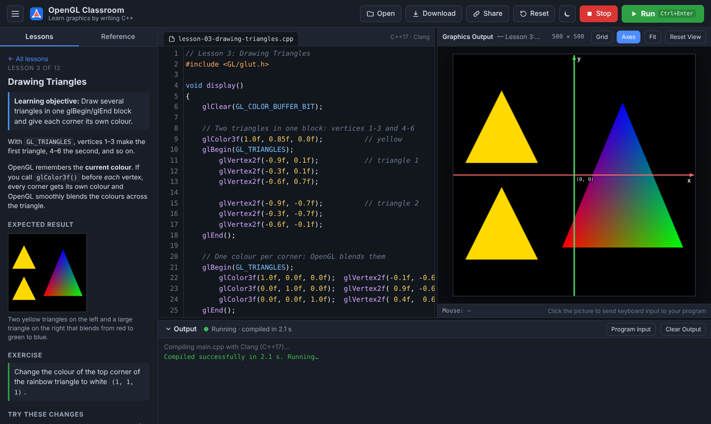

# OpenGL Classroom

**A free, browser-based C++ / OpenGL playground for teaching introductory computer graphics.**
Students open a link, write ordinary C++ with classic OpenGL (`glBegin`, `glVertex2f`, `glTranslatef`, GLUT …), press **Run**, and see the result. Nothing has to be installed and no account is needed. There is no server either.



* Real C++17: your code is compiled by **Clang/LLVM running inside the browser** (WebAssembly). No server compiles anything.
* Classic OpenGL 1.x + GLUT/FreeGLUT through a compatibility layer on WebGL. See **[docs/COMPATIBILITY.md](docs/COMPATIBILITY.md)** for the full list.
* 12 beginner lessons, plus 3 extras (keyboard & mouse, text, 3D & lighting), each with an explanation, a working example, an exercise and a picture of the expected result.
* Beginner-friendly compiler errors (the line is highlighted, with a plain-English hint), readable runtime errors, and protection against infinite loops.
* Coordinate grid and axes overlay, live mouse coordinates, dark/light theme, autosave, download/open `.cpp` files, share links.
* Hosted for free on GitHub Pages. No backend, database, API keys or paid services.

---

## For students

1. Open the link your instructor gave you in a recent Chrome, Edge or Firefox.
2. Pick a lesson on the left, read it, and press **Run** (or **Ctrl+Enter**).
3. Change the code and press **Run** again. Your changes are saved in the browser.
4. **Download** saves your program as a `.cpp` file. **Open** loads one.

The first visit downloads the compiler (about 27 MB, once). After that it loads from the browser's cache in a few seconds.

---

### What runs where

| Where | What happens |
|---|---|
| **GitHub Actions** (once per change) | `npm ci` downloads the Clang toolchain (`@yowasp/clang`) and CodeMirror from npm. `npm run build` compresses the compiler, precompiles `<iostream>`, and writes the static site to `dist/`, which is published to GitHub Pages |
| **GitHub Pages** | Serves static files only. It does **not** compile anything |
| **Student's browser** | Downloads the compiler once, **compiles the C++ to WebAssembly locally**, runs the program in a sandboxed Web Worker, and **renders with WebGL locally** |
| **Instructor's computer** | Nothing is required. Optionally build and test locally (below) |

### Building and testing locally (optional)

Requires [Node.js](https://nodejs.org) 20 or newer.

```bash
npm install          # Clang toolchain (~105 MB unpacked), CodeMirror, test tools
npm run build        # -> dist/ (about 36 MB; the first build takes ~30 s for the precompiled header)
npm run serve        # http://localhost:8080  (for your own testing only)
npx playwright-core install chromium   # once, for the tests
npm test             # acceptance tests against dist/  -> docs/TEST-RESULTS.md
npm test -- --url https://saeedserwan.github.io/opengl/   # test the deployed site
```

`dist/` is plain static files. It can be hosted on any static host (GitHub Pages, Netlify, a university web server), with no special headers needed.

---

## How it works

```
 Student's browser (everything below runs locally)
 ┌───────────────────────────────────────────────────────────────────────────────┐
 │  Editor (CodeMirror) ── C++ source ──▶ Compiler worker                       │
 │                                        Clang + LLD compiled to WebAssembly   │
 │                                        (YoWASP, LLVM 22, libc++, wasi-libc)  │
 │                                        + OpenGL Classroom headers            │
 │                                          GL/gl.h, GL/glu.h, GL/glut.h …      │
 │                                              │                                │
 │                                   program.wasm (the student's program)        │
 │                                              ▼                                │
 │  Graphics panel ◀── OffscreenCanvas ── Runner worker (one per Run)           │
 │  keyboard/mouse ──────────────────▶   • WASI: printf/cout → Output panel     │
 │                                        • glBegin/glVertex/… → LegacyGL       │
 │                                          (OpenGL 1.x pipeline → WebGL)       │
 │                                        • GLUT callbacks driven by the        │
 │                                          browser event loop                  │
 └───────────────────────────────────────────────────────────────────────────────┘
```

* **Compilation really happens.** `clang++ -std=c++17 -O1 main.cpp -o program.wasm` runs in a Web Worker. Errors come straight from Clang. The page never fakes a successful compile.
* **The graphics really come from the program.** The OpenGL headers declare each function as a WebAssembly import. When the compiled program calls `glVertex2f`, the call goes to `js/runtime/legacygl.js`, which implements the fixed-function pipeline (matrix stacks, primitive assembly, lighting) and rasterises with WebGL. Nothing on the page draws a substitute picture. (The optional grid/axes overlay is a separate transparent layer.)
* **`glutMainLoop()`** cannot block a browser. It unwinds out of `main()` (just as Emscripten does) and then the browser's event loop calls the program's display, timer, idle, keyboard and mouse callbacks.
* **Isolation.** Each Run gets a fresh Web Worker, canvas and WebGL context. **Stop**, re-running and infinite loops terminate the worker, which frees all its memory, timers and GPU resources. A watchdog stops programs that stop responding for 5 seconds.

### Why not Emscripten?

Emscripten was evaluated first. Its compiler driver needs Python, Node.js, Clang and Binaryen. Running all of that inside a browser has been demonstrated (e.g. *emception*), but it is far larger, slower and more fragile than plain Clang. Emscripten's own `LEGACY_GL_EMULATION` is also a JavaScript translation layer, the same idea as here. SDL2 is not needed because GLUT is the course's windowing API. The chosen toolchain is the [YoWASP](https://yowasp.org) build of **Clang and LLD for WebAssembly** (npm `@yowasp/clang`), which targets `wasm32-wasi`. The project adds its own OpenGL 1.x / GLUT implementation.

### Limitations

* **Browsers:** current Chrome and Edge (111+) and Firefox (115+) are the targets. Safari 17+ should work but has not been tested. Automated tests run in Chromium. Without `OffscreenCanvas`, programs run on the page itself and an infinite loop can freeze the tab (a warning is shown).
* **First load:** ~27 MB of compiler files (cached afterwards; ~2–4 s to start from cache). Programs that use `<iostream>`, `<string>` or `<vector>` download an extra 8.5 MB precompiled header the first time.
* **Memory:** the compiler uses roughly 400–500 MB of RAM while compiling. Lab PCs with 4 GB of RAM or more are fine.
* **Compile time:** about 0.3–1 s for typical OpenGL programs, ~1–2 s with `<iostream>` (measured in headless Chromium on a cloud server; lab PCs may be slower).
* **OpenGL:** classic OpenGL 1.x subset; no textures, fog or modern shader-based OpenGL. See [COMPATIBILITY.md](docs/COMPATIBILITY.md).
* **C++:** no exceptions, no file I/O, no threads. `cin`/`scanf` read from the *Program input* box.

---

## Customising

* **Lessons:** edit `js/lessons.js` (text, exercises and example code). Pictures of the expected results are in `img/lessons/`. Regenerate them with `npm test -- --thumbs`.
* **Starter code / blank program:** `BLANK` in `js/lessons.js`.
* **Supported OpenGL functions:** headers in `sysroot/include/GL/`, implementation in `js/runtime/`.
* **Compiler flags:** `js/compile-flags.js`.

## Project layout

```
index.html, css/style.css     the IDE page
js/app.js                     page controller: editor, lessons, run/stop, viewport, output
js/lessons.js, js/hints.js    lessons and beginner-friendly error hints
js/compiler-worker.js         runs Clang/LLD (WebAssembly) in a worker
js/runner-worker.js           runs one compiled program in a worker
js/runtime/                   program.js (GLUT + loader), legacygl.js (OpenGL 1.x on WebGL),
                              shapes.js (GLUT/GLU shapes), wasi.js (printf/cin/clock), mat4.js
sysroot/include/              GL/gl.h, GL/glu.h, GL/glut.h, GL/freeglut.h, windows.h stub, …
sysroot/prelude/prelude.h     headers that are precompiled at build time
scripts/build.mjs             builds dist/;  scripts/serve.mjs  local test server
tests/acceptance.mjs          browser tests (pixel checks);  tests/kitchen-sink.cpp
.github/workflows/deploy.yml  GitHub Pages build + deploy + verification
docs/                         COMPATIBILITY.md, TROUBLESHOOTING.md, TEST-RESULTS.md
```

## Licence

OpenGL Classroom is MIT-licensed (see `LICENSE`). Third-party components are listed in [THIRD-PARTY-NOTICES.md](THIRD-PARTY-NOTICES.md): LLVM/Clang (Apache-2.0 with LLVM exception), YoWASP packaging (ISC), CodeMirror 5 (MIT), the Utah teapot data (public domain).
